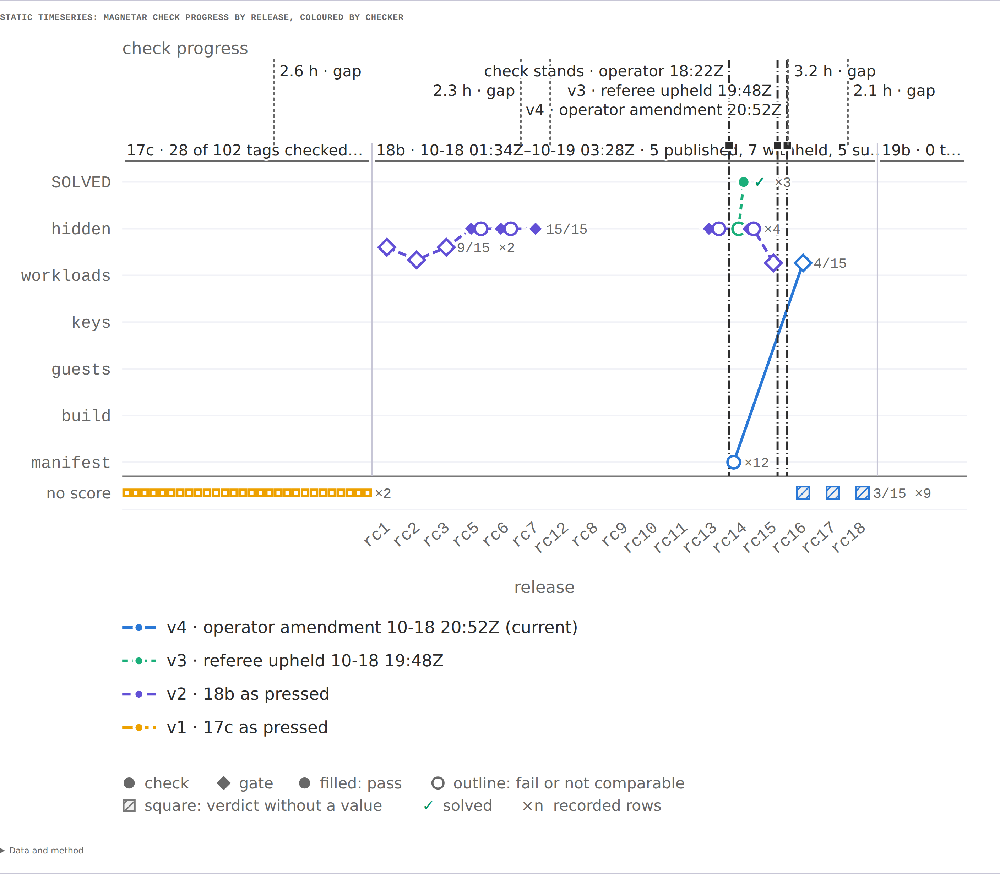
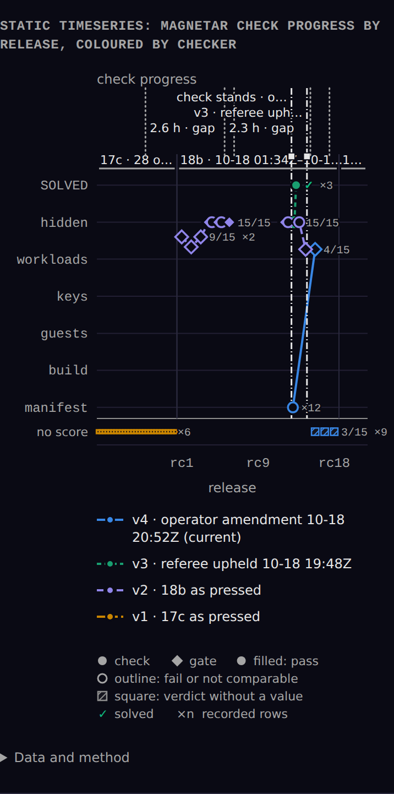
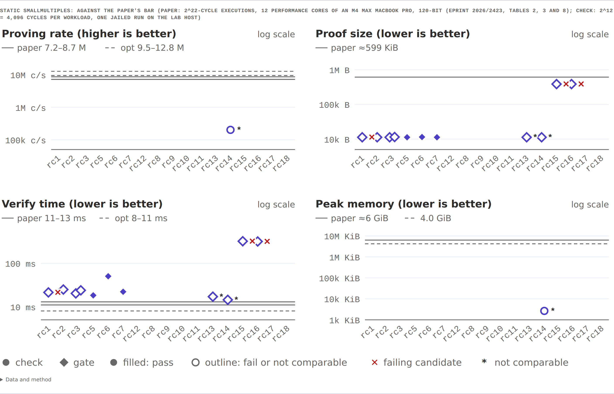
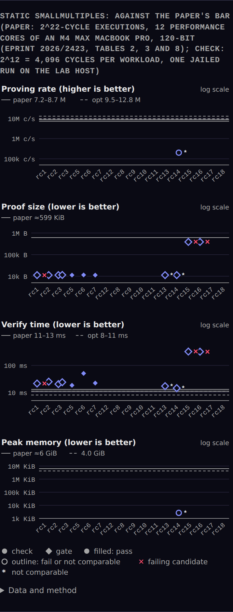

# @tangle-network/charts

Benchmark figures as static SVG and HTML tables, plus optional React timing primitives.

The React entry also exports `DayBars`, `HBars`, `Histogram`, `Lines`, `Meter`, `Spark`, and `Gantt` for live operational pages. Import `@tangle-network/charts/react/live.css` for their layout and set `--chart-live-*` theme tokens on an ancestor. Data, state colors, destination links, labels, and interpretation remain with the caller. `DayBars` accepts an `onOpen(index)` action with keyboard activation.

`WaterfallHeader`, `WaterfallTimeAxis`, `WaterfallBar` and `WaterfallRow` from
`@tangle-network/charts/react` own the timing presentation extracted from
Intelligence's trace viewer. Supply actual span start/end milliseconds and the
same `{ startMs, endMs }` window to every row. Hierarchy, selection, attribution,
formatting and failure interpretation stay with the consumer. The original
minimum/clipped marker remains visible; its tooltip reports the actual duration.
Set `--waterfall-timing-width`, `--waterfall-duration-width` and the existing
`--intel-waterfall-*` colors for the consumer's layout and theme. No stylesheet,
router or React DOM dependency is required.

Five figures cover the decisions a benchmark reader makes:

| Figure | Question |
|---|---|
| `rankedRates` | Which setup solves most, and how uncertain is each rate? |
| `costFrontier` | Which setup gives the most solves per dollar? |
| `comparisonIntervals` | Is each step in the order real? |
| `taskMatrix` | Where does each setup succeed and fail? |
| `breakdown` | Why do attempts fail? |

Operational timings also have three static figures: `heatmap` for complete recorded matrices with producer supplied pass, breach and no-data states; `latencyRange` for p50 dots, p95 bars, a supplied SLO and a minimum observation count; and `phaseWaterfall` for ordered, disjoint phase durations with unaccounted wall time shown explicitly. They return the same `Figure | Refusal` contract.

```ts
import { heatmap, latencyRange, phaseWaterfall } from "@tangle-network/charts";

heatmap(paths, harnesses.map(h => ({
  id: h.id, label: h.label,
  cells: paths.map(p => ({ status: h[p.id].status === "blocked" ? "no-data" : h[p.id].status,
    value: h[p.id].p95Ms === null ? null : h[p.id].p95Ms / 1000 })),
})), { measure: "p95 latency", unit: "s", statusRule: "5 s SLO" });

latencyRange([{ id: "pi", label: "pi", p50Ms: 3572, p95Ms: 4102, n: 9 }],
  { measure: "cold create", sloMs: 5000, minN: 5 });

phaseWaterfall([{ id: "route", label: "Route", ms: 5 }, { id: "restore", label: "Restore", ms: 9500 }],
  { measure: "create", totalMs: 30398 });
```

The producer maps its own blocked or absent states to `no-data`; Charts never assigns a status from a value. `latencyRange` refuses any row below `minN`; when the producer omits those rows, pass their reasons in `excluded` so the note names them. `phaseWaterfall` refuses phases whose sum exceeds the reported total because overlapping spans cannot be drawn as a cumulative waterfall. Its input order is retained, including zero-duration phases. The producer marks known unaccounted leaves with `kind: "unaccounted"`; Charts also marks any difference between their sum and `totalMs`.

The library draws and never decides.
Ranks, intervals, frontier membership, estimate labels and pass counts come from the producer: a board record, a VerticalBench report or an agent-eval lens.
A figure function returns a `Refusal` in place of a figure it cannot draw honestly, for example a bar over too few units, an interval that names no method, or a frontier the producer did not compute.

The producer's `estimate` controls rate marks: `descriptive` draws a rate bar and may show a named Wilson score interval when that estimate meets the producer's unit threshold.
Task-clustered bootstrap intervals require a `bootstrap` estimate.
Intervals without support are marked as not drawn in the data table and note.
Cost-per-pass figures print `unknown` for missing, zero, or unproven cost; zero passes print `no pass`.
A matrix preserves an observed zero cost as $0 and omits a null cost.
Rank numbers require every row to carry both a rank and a `bootstrap` estimate.
For an unranked descriptive report, `rankedRates` accepts `order: "input"` to retain the producer's row order and make no ranking claim.
The default keeps supported ranks or sorts unranked rows by observed rate.
Malformed rates, intervals, matrix counts, and breakdown counts return a refusal instead of a misleading mark.
Unmeasured and flagged matrix attempts keep distinct marks and table counts, even without tier grades.
An interval whisker is omitted when its bounds exclude the row's rate.

The static root has no runtime dependencies and uses no DOM, so it runs in a Worker, a build step or a browser. The separate opt-in `@tangle-network/charts/react` entrypoint requires React; it is never re-exported by the root.

## Use

```ts
import { isRefusal, rankedRates, renderFigure, renderNotes, renderRefusals } from "@tangle-network/charts";
import "@tangle-network/charts/figure.css";

const fig = rankedRates(rows, { measure: "solve rate", passTier: "B" });
const html = isRefusal(fig) ? renderRefusals([fig]) : renderFigure(fig, 1) + renderNotes([fig]);
```

Each figure returns:

- `finding`, `lede` and `read`: sentences generated from the input. No function accepts heading text.
- `svg.wide` (720 px) and `svg.narrow` (358 px, or `null` when the table is the phone view).
- `table`: an HTML table with every number the plot shows.
- `note`: the method, the n and every exclusion, rendered by `renderNotes`.

## Colour

Marks carry classes, and `figure.css` maps them to the `--chart-*` tokens in `@tangle-network/brand` tokens.css.
A render contains no colour value, so it follows the page theme.
A document without brand tokens (a PDF, a sandboxed iframe) embeds `chartTokensCss` and `figureCss` in a `<style>` element.
`chartTokensCss` is light by default, dark under `prefers-color-scheme: dark` or `data-theme="dark"`, and light in print.

One accent marks the measure a reader decides on.
One muted grey marks everything secondary.
An indigo ramp marks App Grade tiers C, B, A and S; F is an outline.
Identity is carried by direct labels, never by hue.

## Develop

```sh
npm ci
npm run gen:css       # after editing src/figure.css or Brand tokens
npm run typecheck
npm test
npm run build         # fails when src/css.generated.ts is stale
```

## Release

Versions publish from this repository's release workflow through npm trusted publishing. Merge the verified change, then push a `vX.Y.Z` tag matching `package.json`; the workflow runs frozen install, typecheck, tests, build, and `npm publish --provenance`.

### Chart-first vertical rates

`rankedRates(rows, { measure: 'pass rate', orientation: 'vertical', order: 'input', identities })` draws vertical bars on a full 0–100% axis.
`order: 'input'` keeps unranked producer order; omit it to keep the existing ordering behavior.
Optional `identities` maps setup IDs to `model` and `harness` marks, each with an explicit `{ label, src }`.
Images must use same-origin absolute paths or HTTPS URLs; the library never infers a provider from a model name.
Hover or focus a column to read its actual count, eligible interval, known cost and run time.
Zero has no positive bar, and ineligible estimates keep their count without a bar.

Use `renderFigure(figure, noteNumber, { presentation: 'chart' })` for a chart-first surface.
The plot fills its container; data, reading instructions and method stay in a closed disclosure.
The default report presentation, underlying table and note links remain available.
Many columns keep a readable minimum width and scroll horizontally.

### Recorded scalar values and histories

`metricBars` draws continuous scores or counts on an explicit zero-based axis.
It preserves input order and draws no rank.
A known zero has no positive bar; a null value prints `not measured`.
Observation counts use the caller's explicit unit.

```ts
import { isRefusal, metricBars, renderFigure, renderRefusals } from "@tangle-network/charts";

const figure = metricBars([
  { id: "a", label: "Setup A", value: 0, observations: { count: 13, label: "tasks" } },
  { id: "b", label: "Setup B", value: null, observations: { count: 0, label: "tasks" } },
], { measure: "mean composite score", unit: "score", domain: [0, 1] });
const html = isRefusal(figure) ? renderRefusals([figure]) : renderFigure(figure, 1, { presentation: "chart" });
```

`timeSeries` draws recorded scalar values at strictly increasing, finite positions.
The caller includes every configured position, with null for a missing observation.
Null breaks the line; the library never interpolates a missing value.

```ts
import { isRefusal, renderFigure, renderRefusals, timeSeries } from "@tangle-network/charts";

const figure = timeSeries([{ id: "a", label: "Setup A", points: [
  { x: 1, y: 0, observations: { count: 13, label: "tasks" } },
  { x: 2, y: null, observations: { count: 0, label: "tasks" } },
  { x: 3, y: 0.5, observations: { count: 5, label: "tasks" } },
] }], { x: { label: "shot", domain: [1, 3] }, y: { label: "mean composite score", unit: "score", domain: [0, 1] } });
const html = isRefusal(figure) ? renderRefusals([figure]) : renderFigure(figure, 1, { presentation: "chart" });
```

Both examples show behavior controls, not benchmark results.
Both functions refuse out-of-domain values, invalid intervals and measured values with zero observations.
Intervals arrive with their recorded bounds, confidence level and method; neither function computes them.
Optional annotations carry independent recorded facts, such as all checks passing.
Hover or focus a mark for its value, observation count, interval and annotation.
The data table retains missing positions and full labels.

### Run events, lanes, parts of a whole and small multiples

A run page draws recorded events, never inferred ones. Every addition below has a static form (`Figure | Refusal`, no DOM) and a React form, takes its colours from Brand tokens through `var()`, and hatches missing data instead of drawing zero.

| Need | Static | React |
|---|---|---|
| Vertical events (first pass, deadline, died, release, steer, ruling, wake) and shaded spans (after pass, idle, no data, blocked) | `timeSeries(rows, { ..., marks, bands })` | `<Lines marks bands>` |
| Lanes of spans with marks; an open span runs to `now` | `timeline(lanes, { measure, now, marks })` | `<Gantt lanes now marks>` |
| An agent tree over time: lanes under their parents, attempt ticks with ok and failed counts, walls across every lane, folding by subtree | `timeline(lanes, { measure, start, now, marks, bands, collapsed })` | `<TimelineView lanes options defaultCollapsed>` |
| Part of a whole with untraced time hatched | `phaseWaterfall` (unaccounted leaves and the remainder are hatched) | `<Meter total segments>` |
| One panel per arm on shared axes, with no-data panels and early ends | `smallMultiples(panels, { x, y, shared })` | `<FigureView figure>` |
| Series that stay distinct without colour | later series add a dash and a marker shape | `series[].dash`, `series[].marker` |

```ts
type ChartMark = { at: number; label: string; kind: "pass" | "deadline" | "died" | "event" | "release" | "steer" | "ruling" | "wake";
  verdict?: "pass" | "fail" | "unknown"; source?: string; lane?: string };
type ChartBand = { from: number; to: number; label: string; kind: "after-pass" | "idle" | "missing" | "blocked" };
type TimelineLane = { id: string; label: string; spans: Array<{ start: number; end: number | null; state: string; note?: string }>;
  parent?: string; depth?: number; ticks?: TimelineTick[]; detail?: string[] };
type TimelineTick = { at: number; outcome: "ok" | "quota" | "lost" | "rate-limit" | "oom" | "refused" | "aborted" | "other"; note?: string };
type MultiplePanel = { id: string; label: string; unit?: string; domain?: [number, number]; points?: TimePoint[];
  missing?: { why: string; detail?: string }; end?: { at: number; kind: ChartMark["kind"]; label?: string }; marks?: ChartMark[] };
type MeterSegment = { label: string; value: number | null; color?: string; kind?: "measured" | "untraced" };
```

Mark kinds differ by stroke as well as colour: pass is solid, deadline dashed, died ends in a cross, and other events are dotted.
A release carries a diamond head, a steer a triangle, a ruling a square and a wake a circle; releases, steers and wakes stop at the plot's edge so frequent events never wall off the data, and a ruling crosses it.
A recorded `verdict` colours a mark (pass and fail take the status tones, unknown the muted tone), and a `source`, such as the operator or the keeper, follows its label.
Mark labels take up to three rows above the data, placed by measured width so none overlap; marks of one kind and verdict at one place share a rule and a label (`rc17 (+18)`), and a label with no room is left to the hover and the table.
A `blocked` band is a system-wide wall, such as a quota window: a breach wash across every lane under a solid top edge.
Marks and bands appear in the figure's table (`Recorded events by …`) and, for React, in a text list under the plot.
`timeSeries` and `smallMultiples` refuse marks or bands outside the x domain, and `timeline` names them at its edge instead (below); React components throw `RangeError` for marks or bands they cannot place, as `StackedBarChart` does.
Axis labels never overlap at 720 or 358 px: `timeSeries` labels recorded positions spread evenly across the plot, and `timeline` uses the smallest clock step (1 min to 7 days) whose labels fit, naming the date at midnight.

`timeline` refuses an open span without `now`, a span, tick or `now` outside a supplied `start`/`end` window and reversed times. States named in `hatch` (default `missing`, `untraced`) are hatched; states in `muted` (default `idle`) use the muted tone.
The window defaults to the extent of the data (spans, ticks and `now`), so a run that ended early is not drawn out to its deadline: a mark past the window, such as the deadline, is named at the edge it falls past with its distance (`Deadline +21.9 h →`), listed in the note, and not drawn; bands are clipped to the window.
Pass `start` (the run's start) to show time before the first span.

Lanes form a tree through `parent`: each lane is drawn under its parent with a connector, siblings and roots keep their input order, and `depth` defaults to the parent's depth plus one. A stated depth that disagrees with the parent, a parent that is not a lane and a parent chain that loops are refused.
`ticks` are recorded attempts, such as driver turns, at the time each ended: ok ticks rise above the bar and failed ticks drop below it in their outcome's colour from the shared outcome palette (below), and the lane ends with its counts, `21✓ 250✗`. A lane without `ticks` shows no counts; an empty `ticks` shows `0✓ 0✗`. Ticks of one outcome within 2 px are drawn as one, with the count and the commonest `note` in its hover. An unknown outcome is refused.
A mark with a `lane` is drawn on that lane only (a steer to one agent, a wake of the root) instead of across every lane; a lane that is not in the figure is refused.
`detail` is the caller's facts about a lane (profile, model, status, attempts, cost, top error), one hover line each on the lane's label and every span, and a column of the lanes table.
`collapsed` folds the named lanes' subtrees: descendants are hidden, the label gains `+N`, and the folded lane's ticks and counts total its subtree. Passing `collapsed`, even empty, makes each parent lane's label a fold toggle (`data-toggle`, a button with `aria-expanded`); `TimelineView` keeps the fold state and wires the toggles to a click, Enter or Space, returning focus to the toggle.
`Gantt` keeps its single-span `rows` input; `lanes` takes the same shape as `timeline` and draws spans only.

`Meter` with `segments` draws each recorded part of `total`; the remainder no segment accounts for is hatched and labelled `untraced` (rename it with `untraced`). A null segment is listed as `not recorded` and takes no width; a missing total hatches the whole track. Parts that sum past the total throw.

`smallMultiples` draws one panel per arm. A `missing` panel is hatched and reads `no data: <why>`; an `end` stops the line at a mark of its kind. It refuses mixed units, values outside the shared domain, points after an end and a missing panel that also carries data. `shared: "x"` keeps one x domain and requires each panel's own y `domain`. The lede counts `n of m <noun>s have data`.

`TimelineView` is `FigureView` around `timeline(lanes, { ...options, collapsed })`; `defaultCollapsed` names the lanes folded on first render.

`FigureView` embeds any static `Figure | Refusal` in React: the wide render in containers of 720 px or more, the phone render (or the table, when a figure has none) below that, and the data, reading and method in a closed disclosure. A refusal renders as its sentence. Import `figure.css` for its styles.

`node scripts/capture-run-page.mjs [dir]` (after `npm run build`) captures each addition at 1440 px light and 390 px dark; the reviewed images are `docs/screenshots/run-page-*.png`.

### Release checks: the climb and the bar

A play's page asks how close its releases are to the check and to the goal's bar. `timeSeries` and `smallMultiples` draw it from the producer's recorded rows; Charts decides no verdict, comparability or checker.

```ts
const climb = timeSeries(rows, {
  x: { label: "release", domain: [-0.5, 16.5], categories: tags.map((tag, at) => ({ at, label: tag })) },
  y: { label: "check progress", unit: "", domain: [-0.05, 1.06], strip: "no score",
    ticks: [...stages.map((label, i) => ({ at: i / stages.length, label })), { at: 1, label: "SOLVED" }] },
  bands: [{ from: 0, to: 16, label: "18b · 5 published, 7 withheld", kind: "group" }],
  marks: [{ at: 9.5, label: "10.5 h", kind: "event", source: "gap" }, { at: 13.47, label: "v4 · operator amendment 20:52Z", kind: "ruling" }],
  markers: { circle: "check", diamond: "gate" },
});
// rows: one per checker (and run), `colorIndex` 0 for the current checker; points such as
// { x: 13, y: 1, verdict: "pass", glyph: "check", marker: "circle", count: 3, firstAt, lastAt, annotation: line }
// { x: 15, y: null, verdict: "unknown", marker: "diamond", label: "6/15", count: 12 }   → the strip, never a height
```

| Field | Drawn as |
|---|---|
| `verdict` | `pass` filled, `fail` outlined, `unknown` dashed; with `y: null`, a square in the strip under the plot (hatched when unknown) |
| `count`, `firstAt`, `lastAt` | `×n` beside the mark; first and last times in the hover and the table |
| `comparable` | `false` outlined with `*`, `null` outlined with `?` |
| `glyph` | `✓` (`check`) or `✕` (`cross`), the only marks in the status tones |
| `marker`, `label` | the mark's shape, named by the figure's `markers`; a short direct label such as `9/15` |
| `y.scale`, `y.targets`, `y.ticks` | log10 y; target bands (dashed when `stretch`); caller-named gridlines |
| `x.categories` | an ordinal axis of weighted columns; points sharing a column are spread across it |
| `colorIndex` (row) | the checker palette, 0 current; dashes follow the index |

The bar panels share the climb's columns: `smallMultiples(panels, { shared: "x", x: { label, domain, categories }, columns: 2, connect: false, markers })`, each panel with its own `unit`, `format`, `scale: "log"`, `domain` and `targets`. `docs/fixtures/magnetar-play.json` holds the Magnetar play's real 17c, 18b and 19b rows in these shapes (`docs/fixtures/export-magnetar-play.mjs` exports them on the Lab host), and `src/run-page-figures.test.ts` draws them.

Attempt outcomes, checkers and run endings have one palette in every view. Green, red and amber are status colours and mean one thing everywhere: an `ok` attempt and a solved run are green, a run that died is red, a stalled run and a rate-limited attempt are amber. `OUTCOME_ORDER` is the stack order (ok, quota, lost, rate-limit, oom, refused, aborted, other; an open attempt is hatched, never an outcome); `OUTCOME_COLORS[outcome]`, `checkerColor(index)` and `ENDING_COLORS[ending]` return the `var(--chart-outcome-*)`, `var(--chart-checker-*)` and `var(--chart-ending-*)` tokens `figure.css` defines as `light-dark()` pairs, so they follow the page's `color-scheme`. Aborted and other are two distinct greys and always carry a label. Checker hues (blue for the current checker, then magenta, cyan and violet) avoid the status colours, so a checker's colour never reads as a verdict; a failing verdict without a value is a neutral ring in the strip. `ENDING_ORDER` is solved, not solved, died, stalled, cancelled, live, never started. `node scripts/palette-check.mjs <dataviz validate_palette.js>` checks both palettes, adjacent pairs in order, on the light surface and on #161616.

| Play page figure | 1440 light | 390 dark |
|---|---|---|
| Climb |  |  |
| Against the bar |  |  |

### Plots without visible report controls

Use `renderFigure(figure, noteNumber, { presentation: "plot" })` to show the responsive plot alone.
The complete data table remains available to assistive technology.
This presentation has no visible finding, method text, disclosure or table control.
Vertical plot axes use larger tick labels.
The existing report and chart presentations keep their output and paper behavior.

Plot presentation uses labels of at least 14px and numeric axes of 15px.
Dedicated phone SVGs retain their intended width inside a keyboard-accessible scroll region.
Wide plots reserve side gutters so enlarged labels remain visible.
These typography rules do not apply to report or chart presentation.

## Optional React renderers

```tsx
import { useState } from "react";
import { Sparkline, StackedBarChart } from "@tangle-network/charts/react";

export function RecordedUnits() {
  const [selectedBucketId, onSelectionChange] = useState<string | null>(null);
  return <>
    <Sparkline label="Completion delta" values={[-2, 0, null, 3]} format={String} />
    <StackedBarChart
      label="Recorded units"
      series={[{ id: "a", label: "Series A", color: "var(--chart-accent)" }]}
      buckets={[
        { id: "first", label: "First window", total: 3, segments: [{ seriesId: "a", value: 3 }] },
        { id: "missing", label: "Second window", total: null, segments: [{ seriesId: "a", value: null }] },
      ]}
      maxValue={10}
      formatValue={(value) => `${value} units`}
      selectedBucketId={selectedBucketId}
      onSelectionChange={onSelectionChange}
    />
  </>;
}
```

Install React 18 or 19 in the consuming app. It is an **optional peer** so static-only consumers need neither React nor its types. There is no React DOM, chart framework or UI-package runtime dependency. The renderers need no generated stylesheet; `figure.css` remains exclusively the unchanged static-figure stylesheet. Supply application font/color styles and readable series colors. Apps with server/client component boundaries mark their interactive wrapper as a client component.

**Different scales, on purpose.** `Sparkline` ports Agent App's observed-extent scale; it does not implicitly include zero. Equal readings sit at mid-height, a single reading is a point, null/nonfinite samples retain their sample index and break the line, and finite negative readings are supported. Width/height props control its viewBox. Its accessible name describes the count, gaps, range and direction; the SVG description contains each sample's formatted value. It is not animated and has no selection interaction. The default `en-US` formatter retains Agent App's two-decimal behavior; pass `format={String}` or a domain-specific formatter when exact precision is important.

`StackedBarChart` always uses the caller's **explicit `[0, maxValue]` domain**. It accepts already-grouped buckets with unique IDs, labels, supplied totals and ordered segments referencing declared series IDs. It never fetches, sorts, groups, calculates billed amounts, chooses a currency, maps products/categories, or invents a maximum. Input bucket order is the sample axis, not an inferred date axis; supply every intended bucket, including gaps. Omitted segments are not synthesized as zero.

A null/nonfinite total or segment makes the whole stack a gap rather than a misleading complete bar. The known values remain in the readout and data table. Zero remains measured zero and draws no positive segment. As in the handoff, positive subpixel segments have a one-pixel visual minimum; their reported values and the total are not changed. Negative or out-of-domain finite values, duplicate/unknown identities, and inconsistent complete totals throw `RangeError` rather than clamp or silently aggregate. Nonnegative stacks do not model credits or diverging signed stacks. The existing static `Refusal` API is unchanged; it is not repurposed as React component state.

Selection is controlled by bucket ID. Hover, focus, click, Enter, Space and touch activation select rather than toggle; mouse leave, blur and Escape dismiss. A removed selected ID shows no stale readout, and reordering never selects another bucket by index. The stabilized SVG keeps full-height hit targets and highlights the actual stack. A named keyboard-scrollable region contains its fluid SVG with a 400px minimum. A cursor-adjacent tooltip repeats the selected values for mouse and pen users. It flips at viewport edges and uses a native manual popover to escape transformed or clipped panels. Browsers without popover support use a fixed-position fallback, which a transformed ancestor can constrain. The selected breakdown remains in flow and live-announced; every bucket also carries its formatted values in its accessible name, and a native “View data” disclosure contains the full table. No Tailwind build or hover-only tooltip is required to read the values.

**Provenance and extraction boundary.** Sparkline comes from `tangle-network/agent-app`, `src/web-react/sparkline.tsx` and its tests at `a8947683a050394d13848bb7e4cbbe7cf08d208e`. Stacked SVG rendering and select-never-toggle regressions come from merged ADC [PR #8746](https://github.com/tangle-network/agent-dev-container/pull/8746), `products/platform/web/src/client/components/UsageChartSvg.tsx` and `UsageChart.test.tsx` at `a1c3958fd73a3894d4515f9dc476dae9ace30ce0`. Platform's aggregation, currency/product/category functions, legend composition and portal-tooltip positioning are **not** copied. The persistent readout and native pointer popover avoid a new React DOM peer. This is not a new universal usage-chart API, a zero-baseline replacement for SpendCard's sparkline, or a consumer migration; Platform and Agent App are not edited.

### Thousands of dots: `DotMap` and `unitDotLayout`

`unitDotLayout(groups, width, height)` places one dot per item in a rectangle per group, the rectangles a squarified treemap sized by count, so a fleet of 6,000 runs reads as its groups first and its items second with no item hidden in an aggregate. It returns the rectangles, every item's `x, y` (interleaved, groups in input order) and a radius per item from its group's cell.

`DotMap` draws those positions, or a semantic map's `x, y`, on one canvas: wheel or pinch zooms about the pointer, drag pans, a click selects, double-click or `0` fits, and `+ - ←→↑↓` work from the keyboard. Colours are palette indexes (`colors: Uint8Array` into `palette`, CSS colours or custom properties), so a lens change repaints without a new layout; `dimmed` greys filtered points, `radii` may vary per point (a dot sized by its run's hours inside its cell), and `labels` name clusters without overlapping. Hit tests use a uniform grid, one path is filled per colour, and the canvas records its last frame's draw time in `data-frame-ms`. The caller owns hover text (`describe`), selection, the legend and the details.

### React and package-boundary checks

```sh
npm ci
npm run typecheck
npm test
npm run build
```

The package-boundary test builds and packs Charts, installs the tarball in an OS-temporary consumer with a normal offline npm install (no peer-omission flags), asserts React/React DOM/React types cannot resolve, and executes the static root without DOM globals. It compares root exports, static SVG/tables, Refusals, report/chart/plot HTML and CSS with the untouched source implementation, then compiles a static-only consumer with `lib: ["ES2022"]`, `types: []` and `skipLibCheck: false`. Only afterward does it supply the installed React peer/types to verify the packed React runtime and declarations. It runs under `npm test`.

The component tests cover gap/zero/one/equal/negative cases, controlled identity, keyboard/touch selection, nonvisual values and resize contracts. The jsdom resize check verifies fluid/minimum-width attributes and preserved selection, **not browser-computed layout**; The retained packed-browser fixture checks Chromium at 1100px and 390px, keyboard selection, emulated touch, light/dark Brand tokens, reduced motion, and top-layer positioning inside a transformed, paint-contained panel. It passes with React 18 and React 19; the React 18 consumer also compiles the packed declarations with React 18 types. Physical touch hardware and screen-reader audio remain unchecked.

### Figure browser proof

`node scripts/render-figures.mjs` writes a comparison page from the retained fixtures and approved speed reference. `node scripts/capture-figures.mjs` uses Playwright Chromium to capture all three figures at phone and desktop widths in light and dark themes. The reviewed images are in [`docs/screenshots`](docs/screenshots).
